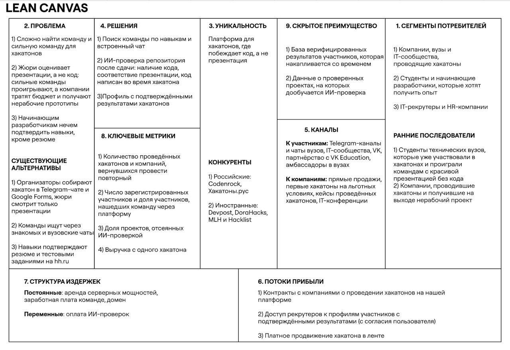
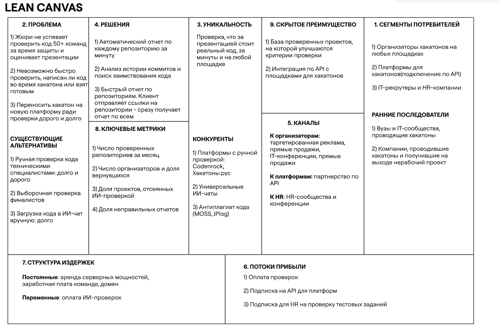

# SyncHub - платформа, где побеждает код, а не презентация.

## Elevator Pitch: SyncHub

Вы когда-нибудь участвовали в хакатоне? Двое суток без сна, команда пишет тысячи строк кода, а побеждают те, у кого красивая презентация и проект, который даже не запускается. Компания-организатор тратит бюджет и получает слайды вместо работающих решений.
SyncHub - платформа для проведения хакатонов, где побеждает код, а не презентация. Здесь можно найти хакатон, собрать команду и сдать проект.
Главное отличие: после сдачи наш ИИ анализирует каждый репозиторий. Он проверяет, что код действительно есть, что он соответствует презентации и написан во время хакатона, а не взят готовым. Пустышки отсеиваются еще до защиты.
Участники получают честную борьбу и подтвержденные достижения в профиле. Компании получают рабочие прототипы и разработчиков, которые умеют писать код, а не только показывать слайды.
Проведите свой следующий хакатон на SyncHub, и пусть побеждает сильнейший!

## Lean Canvas

## HADI

Риск: Будет ли компания платить платформе за проведение хакатонов

H (Hypothesis): Компании тратят бюджет на проведение хакатонов, но на выходе не получают ценных кандидатов: побеждают красивые презентации, а не работающий код.

A (Action): Поговорить с амбассадорами 10 крупных компаний в вузах, а также написать на почту с предложением еще 20 компаниям, и предложить им провести хакатон за 30 000 рублей. В самом начале проверка будет осуществляться в ручном формате. После хакатона предлагаем компании провести следующий уже по полной цене.

D (Data): количество компаний, согласившихся провести первый хакатон за 30 000 рублей; количество компаний, согласившихся провести повторный хакатон по полной цене.

I (Insights): не менее 10 из 30 компаний (33%) согласились провести первый хакатон;
не менее 5 из согласившихся (50%) провели или согласились провести повторный хакатон по полной цене.

## Unit-экономика

Цена первого хакатона 30 000 рублей, последующих - 50 000 рублей. Частота проведения хакатонов одной компанией - 2 раза в год; срок жизни - 2 года(4 хакатона)

### CAC

Таргетированная реклама в VK  на HR и техлидов - 2000 кликов * 60рублей = 120 000 рублей
Сколько человек после клика отправили заявку на участие - 3% = 60 заявок
Сколько захотели провести встречу/созвон после подачи заявки - 50% = 30 встреч
Сколько человек после обсуждения деталей согласились работать - 33% = 10 компаний

CAC = 120 000 / 10 = 12 000 рублей

### LTV

Стоимость сервера для 1 хакатона  = 5000р
ИИ-проверка 1 хакатона = (200 000 токенов * 1рубль за 1000 токенов + 25% на повторную сдачу или перепроверку) * 50 команд = 12 500 рублей

Расходы на 1 хакатон = 17 500 рублей

Первый хакатон = 30 000 - 17 500  = 12 500рублей
Последующие = 3 * (50 000 - 17 500) * 50% = 48 750 рублей

LTV = 61 250 рублей

LTV / CAC = 61 250 / 12 000 = 5.1 (Экономика сходится)

## План Б (Pivot)

Вместо полноценной платформы для проведения хакатонов продаём одну функцию - **ИИ-проверку репозиториев**. Она работает как отдельный сервис и встраивается в любой процесс: компания проводит хакатон где угодно (Codenrock, Telegram-чат, свой сайт), а перед защитой загружает ссылки на репозитории в SyncHub Check и получает отчёт по каждой команде:
- код есть и запускается;
- код соответствует презентации;
- код написан во время хакатона, а не взят готовым

### Elevator Pitch: план Б

Вы организуете хакатон: 50 команд, у жюри по паре минут на каждую. Проверить код никто не успевает, поэтому побеждает лучшая презентация. А переносить хакатон на новую платформу ради проверки долго и дорого. SyncHub - сервис ИИ-проверки репозиториев, который работает с любой площадкой: Codenrock, Telegram-чатом или вашим сайтом. Загрузите ссылки на репозитории, и через несколько минут получите отчёт по каждой команде: есть ли код и запускается ли он, соответствует ли он презентации, написан ли он во время хакатона. Жюри тратит время только на настоящие проекты, а компания получает рабочие прототипы и сильных разработчиков за 500 ₽ за команду. Подключите SyncHub к вашему следующему хакатону, и пусть побеждает код, а не слайды!

### Lean Canvas для плана Б
